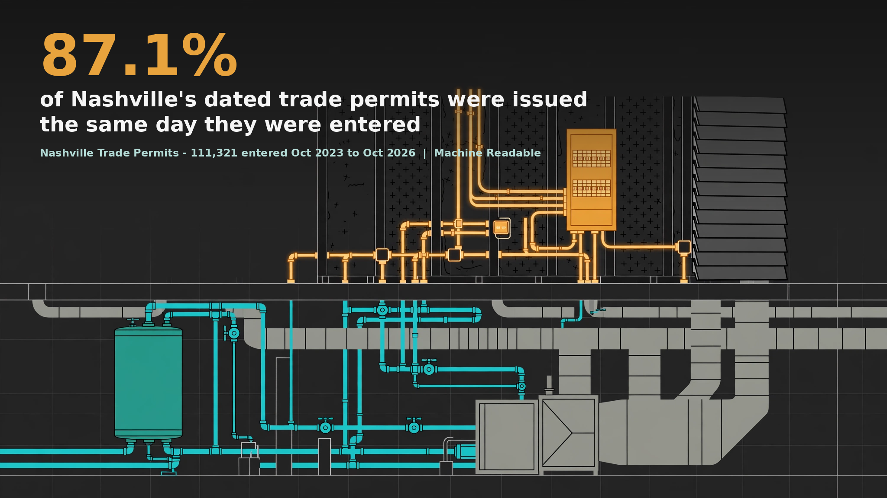

# Nashville Trade Permits - a Machine Readable data brief



Of the **111,321 trade permits** entered in Metro Nashville between October 12, 2023 and October 16, 2026, 107,213 carry an issuance date, and **87.1 percent of those were issued the same day they were entered**, while the median building permit in the companion register waited 29 days. The volume spreads across all 35 council districts (the largest holds 5.9 percent), 43.2 percent of electrical permits are service-connection events (releases and reconnects), and the largest projects cluster downtown: 117 of the 141 parcels whose trade permits state a project value of $10 million or more are in District 19.

Full brief: [brief-draft.md](brief-draft.md) | Sources: [sources.md](sources.md) | Verification: [verification.md](verification.md)

## Contents

- `brief-draft.md` - the brief
- `hero.png` - headline graphic (generated illustration, brand palette, headline composited on top)
- `charts/` - trade split, entry-to-issuance gaps, districts, same-day share by permit kind
- `stats.json` - every headline figure with its population printed
- `data/` - panels, the pre-flight audit output, and the independent verifier output. The raw snapshot is retained as a parquet in the project warehouse stack (stack/nashville/snapshots/2026-11-06/trade_permits_raw.parquet) and is reproducible any time with `code/pull_data.py`; the package CSV withholds the source's Contact column
- `code/` - `pull_data.py`, `build_stats.py`, `audit_section10.py`, `verify_independent.py`, `charts.py`, `hero_composite.py`
- `verification.md` - pre-flight audit summary, methods checklist, sync gate, story gate

## Reproduce

```
python3 code/pull_data.py          # full-view pull from the live service (snapshot will drift from the archived one;
                                   # the archived CSV withholds the source's Contact column, names are never published)
python3 code/audit_section10.py    # writes data/audit_output.txt
python3 code/build_stats.py        # writes stats.json and data/*_panel.csv (expects data/parcel_join_summary.json in the package)
python3 code/verify_independent.py # second implementation (pandas) + live server aggregates
python3 code/charts.py
```

## Source

Nashville Trade Permits (Trade_Permits_View), Metro Nashville / Davidson County via hubNashville open data, ArcGIS FeatureServer layer 0 (services2.arcgis.com/HdTo6HJqh92wn4D8). Snapshot November 6, 2026. Companion briefs: [building permits issued](https://github.com/adowlen/nashville-building-permits-data-brief) (November 3, 2026) and [building permit applications](https://github.com/adowlen/nashville-building-permit-applications-data-brief) (November 4, 2026).

## License

Brief text and derived data products: CC BY 4.0 (see LICENSE). Underlying records are Metro Nashville government open data. Applicant contact names appear in the source records and are never published here.

*Machine Readable is a public-good civic data project by Alex Dowlen.*
